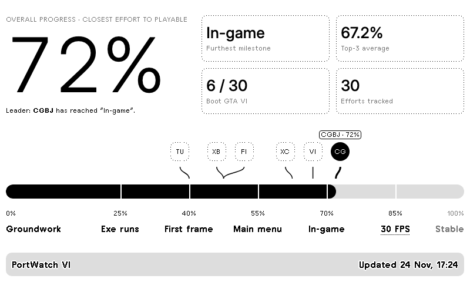
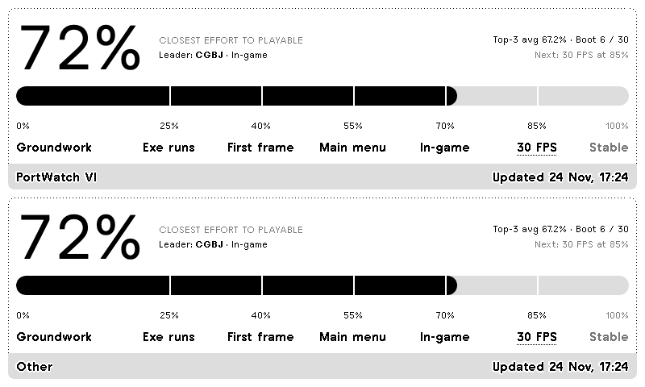
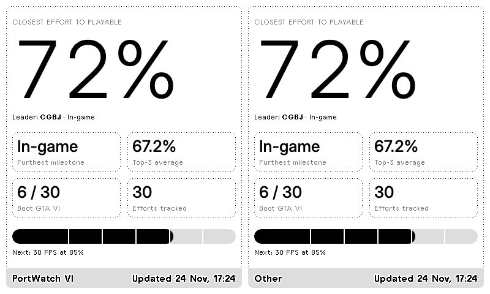
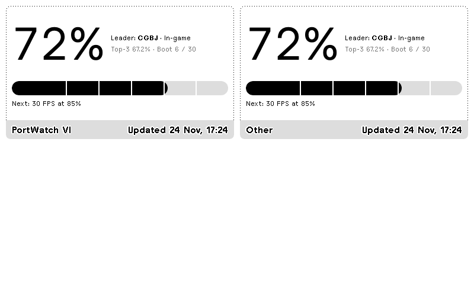

# PortWatch VI – TRMNL plugin

Shows how close the community is to running GTA VI on PC, on a [TRMNL](https://trmnl.com) e-ink display. It reproduces the "Overall progress · Closest effort to playable" panel of [PortWatch VI](https://portwatch-vi.xyz): the leader's score, four key figures, the top 6 efforts on the progress bar and the seven milestones.



This is an unofficial plugin. PortWatch VI is made by [4lwayz](https://github.com/4lwayz/portwatch-vi); this repo only reads its public data and copies its scoring rules so the numbers match the site.

## How it works

```text
portwatch-vi.xyz/data/tracker.json   (~200 KB, refreshed every 3 hours by the site)
  → GitHub workflow, every hour at :47 (.github/workflows/build-data.yml)
      1. scripts/build-data.mjs  scores every effort and writes data/trmnl.json (~2 KB)
      2. scripts/check-drift.mjs compares the result with the site's own scoring.js
      3. commits data/trmnl.json, only if it changed (each site refresh)
  → TRMNL polls data/trmnl.json and renders src/*.liquid
```

TRMNL does not poll `tracker.json` directly because private plugins whose polled response is over about 100 KB get degraded.

If step 1 or 2 fails, nothing is committed, and the display keeps showing the last good data. GitHub emails the repo owner when a scheduled run fails. A failure in step 2 means the site changed how it scores efforts, and `scripts/build-data.mjs` needs the same change.

`check-drift.mjs` runs code downloaded from portwatch-vi.xyz, so the workflow gives it no push access: only the commit step receives the token.

## Install on TRMNL

TRMNL imports a private plugin from a zip holding `settings.yml` and the `.liquid` files, with no folders inside ([TRMNL's import guide](https://help.trmnl.com/en/articles/10542599-importing-and-exporting-private-plugins)). `src/` is laid out that way.

1. Build the zip from a copy of this repo (macOS and Linux):

   ```bash
   cd src && zip -j ../portwatch-vi-trmnl.zip settings.yml *.liquid && cd ..
   ```

   Don't use macOS Finder's **Compress "src"** or GitHub's **Download ZIP**: they put the files inside a folder, and TRMNL then answers "The ZIP file does not contain settings.yml".

2. In TRMNL, open the **Private Plugin** settings page, click **Import new** and choose `portwatch-vi-trmnl.zip`. TRMNL creates the plugin and adds it to your playlist.

The zip sets everything: polling `https://raw.githubusercontent.com/nlhomme/trmnl-gtavi-portwatch/main/data/trmnl.json` with GET, a refresh every 60 minutes, no transform (the data is already in its final shape), and the markup for the Shared tab and the four sizes.

To set it up by hand instead, create a Private Plugin with the values of `src/settings.yml`, then paste `shared.liquid` into the **Shared** tab and each other `.liquid` file into the tab of the same size.

## Screen sizes

| Size | Shows |
|---|---|
| Full | Everything: score, leader, 4 figures, top 6 markers, bar, 7 milestones |
| Half horizontal | Score, leader, top-3 average, boots, next milestone, bar, 7 milestones |
| Half vertical | Score, leader, 4 figures, bar, next milestone (too narrow for markers and milestone labels) |
| Quadrant | Score, leader, top-3 average, boots, bar, next milestone |

Every size shows, in its title bar, when PortWatch VI last refreshed its data ("Updated 24 Nov, 14:29", in the device owner's time zone).

| Half horizontal | Half vertical | Quadrant |
|---|---|---|
|  |  |  |

The previews were rendered locally in Chrome with TRMNL's CSS, not on a device.

## Data: `data/trmnl.json`

Generated by `scripts/build-data.mjs`; never edit it by hand.

| Field | Meaning | Example |
|---|---|---|
| `updated` | When the site last refreshed its data (ISO, UTC); shown in the title bar as "Updated 24 Nov, 14:29" in the device owner's time zone | `"2026-11-24T13:29:54.857Z"` |
| `score` | Leader's score, 0–100 | `72` |
| `leader` | Leader's name | `"CGBJ"` |
| `leader_reached_label` | Last milestone the leader reached | `"In-game"` |
| `furthest_label` | Furthest milestone any effort reached | `"In-game"` |
| `top3` | Average score of the top 3 | `67.2` |
| `booted` | Efforts that reached "First frame" | `6` |
| `tracked` | Efforts listed on the site | `30` |
| `milestones[]` | The 7 milestones: `label`, `at` (% on the bar), `left` (start of its 14%-wide label box), `state` (`reached`, `next` or `todo`) | |
| `markers[]` | Top 6 efforts on the bar: `name`, `initials`, `score`, `x` (true position), `a` (drawn position, spread so markers don't overlap), `left` (start of its 12%-wide box), `leader` (`true` for the leader) | |

## Run the scripts by hand

Needs Node.js 22 or later, no packages.

```bash
node scripts/build-data.mjs    # writes data/trmnl.json from the live site
node scripts/check-drift.mjs   # compares data/trmnl.json with the site's scoring.js
```

`build-data.mjs` was tested locally. `check-drift.mjs` was not, because it runs code from the site; it first runs in the GitHub workflow.

To run the workflow without waiting for the hour: **Actions → Build TRMNL data → Run workflow**.
